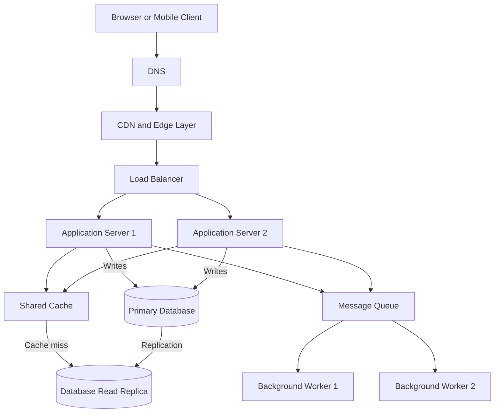

# QuickNotes System Architecture

## 1. Functional and Non-Functional Requirements

### Functional Requirements

The system must allow users to:

- Register and authenticate securely.
- Create, view, update, and delete notes.
- Organize notes using tags.
- View notes in a list, with pagination and sorting.
- Receive clear error messages when requests fail.

### Non-Functional Requirements

The system should provide:

- **Scalability:** Support 1 million registered users and handle increased traffic.
- **Availability:** Continue serving requests when an application server fails.
- **Performance:** Return common requests quickly by using caching and efficient database queries.
- **Security:** Authenticate users, authorize access to their notes, validate inputs, and protect sensitive data.
- **Data integrity:** Prevent unauthorized access and maintain consistent relationships between users, notes, and tags.
- **Maintainability:** Use modular application components that can be updated independently.

## 2. Load Estimates for 1 Million Users

The following estimates use explicit assumptions for planning. They are not measurements from a live application.

### Assumptions

- Registered users: 1,000,000.
- Daily active users (DAU): 10% of registered users, or 100,000.
- Each active user makes 20 read requests per day.
- Each active user creates 2 notes per day.
- Average stored size per new note, including basic metadata: approximately 1 KB.
- Peak traffic is estimated at 5 times the average traffic.

### Read Requests Per Second

Daily reads:

100,000 active users × 20 reads = 2,000,000 reads/day.

Average reads per second:

2,000,000 ÷ 86,400 ≈ 23 reads/second.

Estimated peak:

23 × 5 ≈ 116 reads/second.

### Write Requests Per Second

Daily note creations:

100,000 active users × 2 notes = 200,000 notes/day.

Average write rate:

200,000 ÷ 86,400 ≈ 2.3 writes/second.

Estimated peak:

2.3 × 5 ≈ 12 writes/second.

These write estimates cover note creation only. Updates, deletions, tag changes, and other database operations would add to the total.

### Annual Storage Growth

Daily storage growth:

200,000 notes × 1 KB ≈ 200 MB/day.

Annual raw storage:

200 MB × 365 ≈ 73 GB/year.

Allowing an additional 30% for indexes and other database overhead gives approximately 95 GB/year.

This estimate excludes backups, replicas, logs, attachments, and any additional storage required by database implementation details. Actual storage would depend on note sizes and usage patterns.

## 3. System Architecture

The following architecture separates request handling, data storage, caching, and background processing.

### Component Responsibilities

**1. Browser or mobile client**

Provides the user interface for viewing and managing notes. It sends HTTP requests to the backend API.

**2. DNS (Domain Name System)**

Translates the application's domain name into the appropriate network destination.

**3. CDN (Content Delivery Network)**

Caches eligible static assets such as CSS, JavaScript, and images close to users. Private or user-specific note data must not be publicly cached.

**4. Load balancer**

Distributes incoming API requests across available application servers. It can stop routing traffic to unhealthy instances.

**5. Application servers**

Run the backend API, authenticate users, authorize note access, validate requests, and apply business rules. Multiple servers allow the application to handle more traffic and tolerate an individual server failure.

**6. Shared cache**

Stores frequently requested data temporarily, reducing repeated database reads and improving response times. Cached note data must be scoped by user and invalidated or updated when relevant notes change.

**7. Primary database**

Stores authoritative application data, including users, notes, tags, and their relationships. Writes are directed to the primary database.

**8. Database read replica**

Receives replicated data from the primary database and handles suitable read queries. Replication may lag, so recently written data might not immediately appear on the replica.

**9. Message queue**

Holds background jobs so that non-essential work does not delay the main API response.

**10. Background workers**

Process queued jobs, such as sending notifications or updating search indexes. Failed jobs should be retried safely, without unintentionally duplicating work.

## 4. Request Flows

### GET /notes — Retrieve Notes

1. The client sends a request to `GET /notes`.
2. DNS resolves the application's domain, and the request passes through the CDN and load balancer.
3. An application server authenticates the user and verifies their permissions.
4. The application checks the shared cache for the requested user's notes and pagination parameters.
5. On a cache hit, the application returns the cached result.
6. On a cache miss, the application queries the read replica when appropriate. It may query the primary database when fresh data is required.
7. The application caches eligible results and returns the notes in a JSON response.

The application must ensure that users can only access their own notes. Cache keys must also distinguish users and relevant query parameters.

### POST /notes — Create a Note

1. The client sends a `POST /notes` request containing the note title and body.
2. The request passes through DNS, the CDN, and the load balancer to an application server.
3. The application authenticates the user, validates the request, and checks authorization.
4. The application inserts the new note into the primary database.
5. After the database transaction succeeds, the application returns `201 Created` with the new note's details.
6. A background job can then update a search index or send a notification if required.

The database write must succeed before the API reports that the note has been created. Background processing should be reliable, for example by using a transactional outbox when losing a queued job would be unacceptable.

## 5. Trade-Offs and Design Decisions

### Trade-Off 1: Caching vs. Data Freshness

Caching reduces database load and improves read performance. However, cached data can become stale after a note is updated or deleted.

**Decision:** Cache frequently accessed results and invalidate or update affected cache entries after successful writes. Use short expiration periods as an additional safeguard.

### Trade-Off 2: Read Replicas vs. Immediate Consistency

Read replicas distribute read traffic and reduce pressure on the primary database. However, replication lag can cause a user to see older data immediately after making a change.

**Decision:** Send normal list queries to a replica when eventual consistency is acceptable. Read recently changed data from the primary database when stronger read-after-write consistency is required.

### Trade-Off 3: Synchronous vs. Asynchronous Processing

Performing every task during an API request can make responses slow. Moving background work to a queue improves responsiveness, but introduces additional infrastructure and failure-handling requirements.

**Decision:** Save the note synchronously, then process non-essential tasks asynchronously. Use retries, monitoring, and idempotent job handlers.

### Trade-Off 4: Availability vs. Cost

Running multiple application servers, replicated databases, and highly available infrastructure increases reliability but also increases operating costs.

**Decision:** Start with a practical deployment and add redundancy where justified by availability requirements. Scale individual components as actual traffic and service objectives demand.

## 6. Single Points of Failure and Mitigation

A single point of failure (SPOF) is a component whose failure can interrupt the entire service or a critical function.

| Potential SPOF          | Mitigation                                                                                                                    |
| ----------------------- | ----------------------------------------------------------------------------------------------------------------------------- |
| One application server  | Run multiple instances behind a health-checking load balancer.                                                                |
| Primary database        | Use managed database failover, automated backups, and tested recovery procedures.                                             |
| One read replica        | Provide additional read capacity or a fallback to the primary when safe and necessary.                                        |
| Shared cache            | Use a highly available cache where justified, and allow the application to fall back to the database during cache failures.   |
| Message queue or worker | Use durable queues, redundant workers, retries, and monitoring of failed jobs.                                                |
| DNS or CDN provider     | Use reliable providers, monitor availability, and evaluate a documented recovery strategy appropriate to the service's needs. |

A read replica alone does not eliminate database failure risk. Database failover, backups, recovery testing, and appropriate redundancy are also necessary.

## Conclusion

QuickNotes can support growth by separating request handling, data storage, caching, and background processing. Multiple application servers improve horizontal scalability, while a primary database and read replicas separate write operations from suitable read workloads.

The estimates provide a starting point for capacity planning. In a real deployment, monitoring, load testing, database performance, and actual user behavior would guide further scaling decisions.
